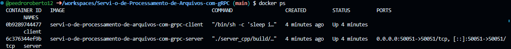
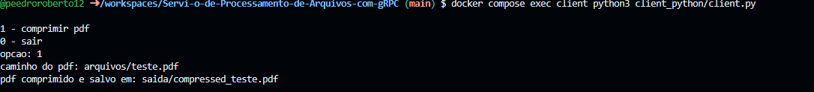
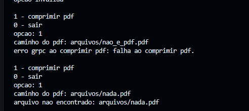
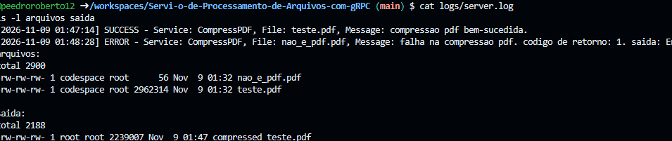

# Relatório - Entrega 1 (CompressPDF)

**Integrantes:** 

## Implementação

O serviço CompressPDF recebe um PDF do cliente Python, comprime no servidor C++ usando o Ghostscript e devolve o arquivo comprimido.

O cliente lê o PDF e manda em pedaços de 1 KB pelo stream do gRPC. O nome do arquivo vai no primeiro pedaço. O servidor junta os pedaços, salva o arquivo em `/tmp`, roda o comando `gs` do enunciado, devolve o resultado também em pedaços e depois apaga os temporários. Toda operação fica registrada no `server.log` com data/hora, serviço, arquivo e status (SUCCESS ou ERROR).

O servidor e o cliente rodam em containers separados, criados com docker-compose na mesma rede, seguindo o modelo do laboratório de MPI.

## Decisões de design

- Usamos stream bidirecional (`stream FileRequest` → `stream FileResponse`) para mandar e receber o arquivo em partes, sem depender do tamanho máximo de mensagem do gRPC.
- Em caso de erro o servidor retorna um status do gRPC (`INVALID_ARGUMENT` ou `INTERNAL`) e o cliente mostra a mensagem.
- A saída do `gs` é capturada com `popen` para registrar no log o motivo da falha.
- Dois Dockerfiles: o do servidor tem compilador, gRPC e Ghostscript; o do cliente só Python e grpcio. Usamos Ubuntu 24.04 por causa da versão mais nova do gRPC.
- Volumes no compose para o log, os arquivos de entrada e os de saída aparecerem direto na pasta do projeto.

## Desafios

- O `.proto` de exemplo usava `stream` dentro das mensagens, o que não compila no proto3. Passamos o `stream` para a definição dos rpcs.
- O código C++ de exemplo misturava chamada unária com stream e não compilava. Trocamos para `ServerReaderWriter`.
- O comando `gs` do exemplo tinha espaços em `-dPDFSETTINGS = / ebook`, corrigimos para `-dPDFSETTINGS=/ebook`.

## Testes

- PDF válido (`arquivos/teste.pdf`): comprimido e salvo em `saida/`, de 2.962.314 para 2.239.007 bytes (cerca de 24% menor).
- Arquivo que não é PDF (`arquivos/nao_e_pdf.pdf`): o gs falha, o cliente recebe erro e o log registra.
- Arquivo inexistente: o cliente avisa sem chamar o servidor.

## Prints

**Containers rodando** (`docker ps`): servidor e cliente ativos, com a porta 50051 do servidor publicada.

**Menu do cliente:**

**Compressão com sucesso:** o `teste.pdf` foi comprimido e salvo em `saida/`.

**Testes de erro:** arquivo que não é PDF (o gs falha e o servidor devolve erro) e arquivo inexistente (o cliente avisa sem chamar o servidor).

**Log do servidor e tamanho dos arquivos:** o `server.log` registra o sucesso e a falha, e o `ls` mostra o PDF comprimido menor que o original.

