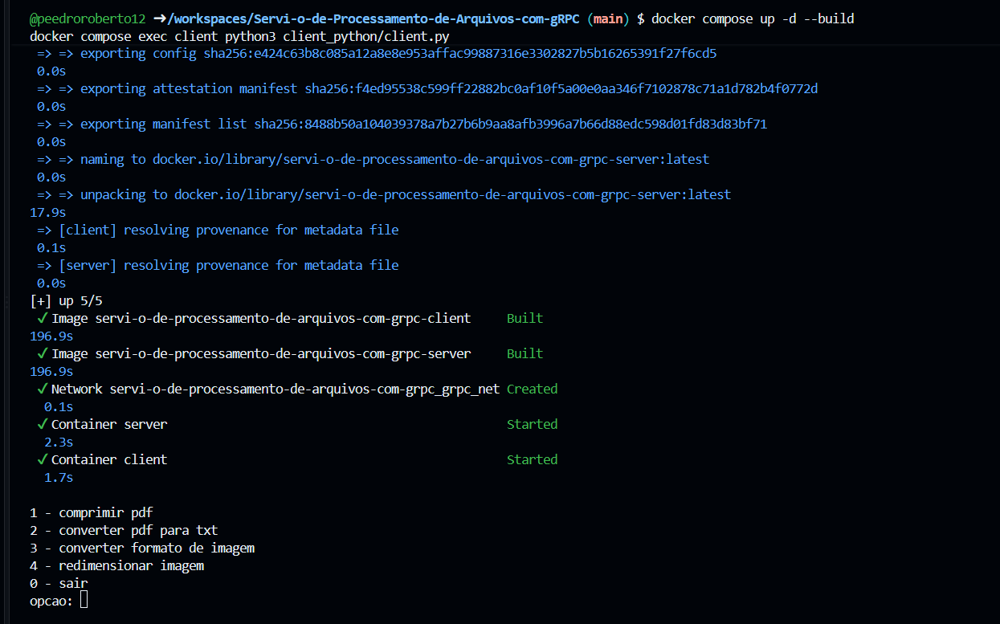
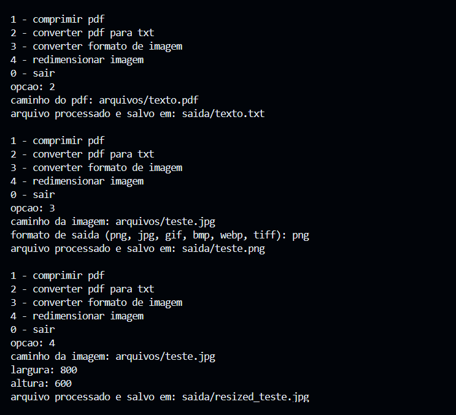
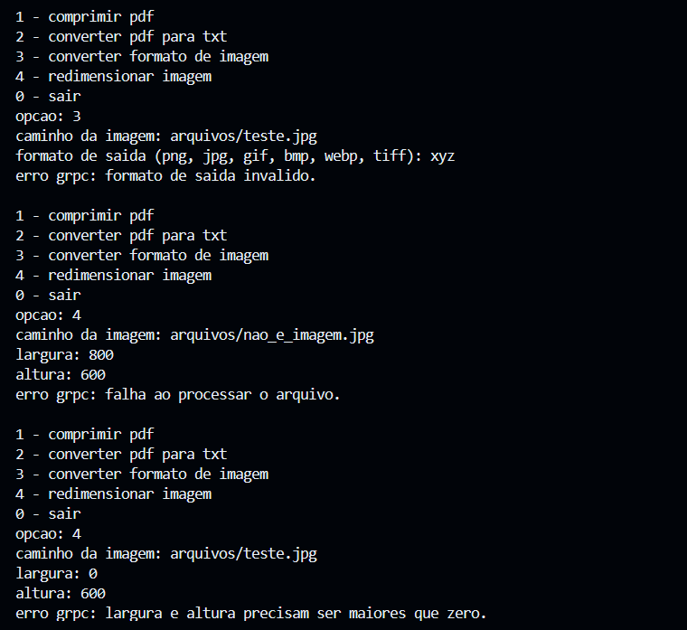
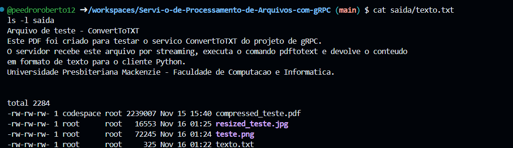
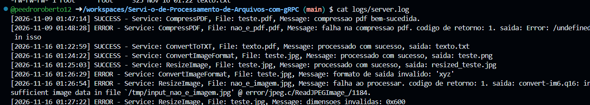

# Relatório - Entrega 2 (ConvertToTXT, ConvertImageFormat e ResizeImage)

**Nome:** Pedro Roberto Fernandes Noronha  
**RA:** 10443434

## Implementação

Nesta entrega foram implementados os três serviços que faltavam: ConvertToTXT, ConvertImageFormat e ResizeImage. Eles seguem o mesmo fluxo do CompressPDF da entrega 1: o cliente Python manda o arquivo em pedaços pelo stream do gRPC, o servidor C++ salva o arquivo em `/tmp`, roda o comando, devolve o resultado também em pedaços e registra tudo no `server.log`.

- ConvertToTXT: recebe um PDF e devolve o texto usando `pdftotext`.
- ConvertImageFormat: recebe uma imagem e o formato de saída e converte com `convert` do ImageMagick.
- ResizeImage: recebe uma imagem, a largura e a altura e redimensiona com `convert -resize`.

No servidor, a parte que se repetia em todos os serviços (receber o arquivo, salvar, rodar o comando, devolver e gravar no log) foi separada nas funções `ReceberArquivo` e `Processar`. Assim cada serviço só monta o seu comando. No cliente o menu ganhou as opções 2, 3 e 4 e uma função `processar_arquivo` serve para os quatro serviços.

O `.proto` não precisou mudar, os métodos e os parâmetros (`output_format`, `width` e `height`) já estavam definidos desde a entrega 1. No `Dockerfile.server` foram adicionados os pacotes `poppler-utils` e `imagemagick`.

## Decisões de design

- Os parâmetros de cada serviço vão no primeiro pedaço do stream, junto com o nome do arquivo, usando o `oneof` do `.proto`.
- O formato de saída só é aceito se estiver numa lista (png, jpg, jpeg, gif, bmp, webp e tiff), já que ele vai para o nome do arquivo e para o comando.
- Largura e altura precisam ser maiores que zero, senão o servidor retorna `INVALID_ARGUMENT` sem rodar o comando.
- O cliente junta os pedaços e só salva o arquivo no final, quando a resposta chegou inteira.

## Desafios

- No primeiro teste o ImageMagick aceitou o formato `xyz` e gerou um arquivo sem utilidade, sem dar erro. Foi resolvido com a lista de formatos aceitos.
- O cliente abria o arquivo de saída antes da resposta e apagava ele se desse erro. Num teste com erro ele apagou o `resized_teste.jpg` gerado antes com sucesso. Foi corrigido salvando o arquivo só depois de receber tudo.
- Pedindo 800x600 a imagem saiu com 800x450, porque o `convert -resize` mantém a proporção da imagem por padrão. Isso foi mantido para a imagem não ficar distorcida.

## Testes

- ConvertToTXT com `arquivos/texto.pdf`: gerou `saida/texto.txt` com o texto do PDF.
- ConvertImageFormat com `arquivos/teste.jpg` para png: gerou `saida/teste.png`.
- ResizeImage com `arquivos/teste.jpg` em 800x600: gerou `saida/resized_teste.jpg`.
- Formato `xyz`: o servidor recusa com "formato de saida invalido".
- Arquivo que não é imagem (`arquivos/nao_e_imagem.jpg`): o `convert` falha, o cliente recebe erro e o log registra a saída do comando.
- Largura 0: o servidor recusa com "largura e altura precisam ser maiores que zero".

## Prints

**Build dos containers e menu com os quatro serviços:**

**Os três serviços novos funcionando:**

**Testes de erro:** formato inválido, arquivo que não é imagem e largura 0.

**Arquivos gerados:** conteúdo do `texto.txt` e arquivos na pasta `saida`.

**Log do servidor:** registros da entrega 1 e da entrega 2, com sucesso e erro.

## Declaração e Análise do Uso de IA

### Registro de uso

Claude, modelo Opus 5.5.

A IA foi usada para lembrar o que a entrega 2 pedia, implementar os três serviços no servidor C++ e as novas opções no cliente Python, separar as partes repetidas do servidor em funções, atualizar o Dockerfile e o README, criar os arquivos de teste e montar este relatório. Os testes no Codespace e os prints foram feitos por mim.

### Análise crítica

As respostas estavam corretas e o código funcionou no Codespace, mas a IA errou duas coisas na primeira versão (aceitar qualquer formato e apagar arquivo bom quando dava erro) e só percebeu nos testes, então os testes foram importantes para pegar isso.

Em relação ao aprendizado, ajudou a ver como reaproveitar o mesmo fluxo de streaming para serviços diferentes mudando só o comando, e a entender o comportamento do `convert` com o `-resize`. O risco continua sendo usar o código sem entender, por isso é necessário revisar cada parte e usar a ferramenta como auxiliar.

## Conclusão

Com a entrega 2 o servidor ficou com os quatro serviços pedidos: CompressPDF, ConvertToTXT, ConvertImageFormat e ResizeImage. Todos usam streaming nos dois sentidos, tratam erros com status do gRPC e registram cada operação no `server.log`. Separar a parte comum em funções deixou o código menor e fácil de estender para novos serviços.

## Referências

GRPC. gRPC C++ Basics Tutorial. Disponível em: https://grpc.io/docs/languages/cpp/basics/. Acesso em: 15 nov. 2026.

POPPLER. pdftotext manual. Disponível em: https://manpages.ubuntu.com/manpages/noble/man1/pdftotext.1.html. Acesso em: 15 nov. 2026.

IMAGEMAGICK. Command-line Options: -resize. Disponível em: https://imagemagick.org/script/command-line-options.php#resize. Acesso em: 15 nov. 2026.

IMAGEMAGICK. Image Formats. Disponível em: https://imagemagick.org/script/formats.php. Acesso em: 15 nov. 2026.
